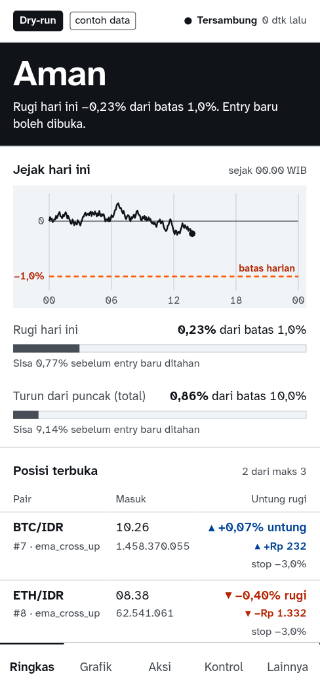
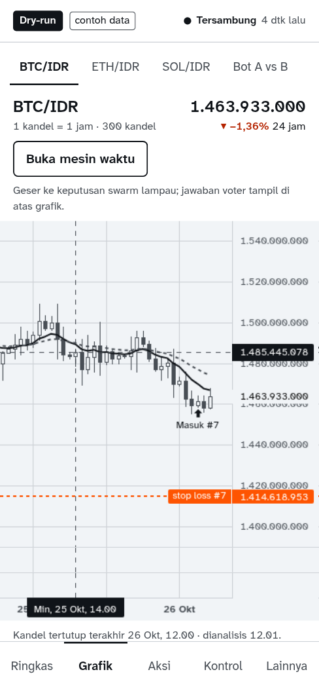
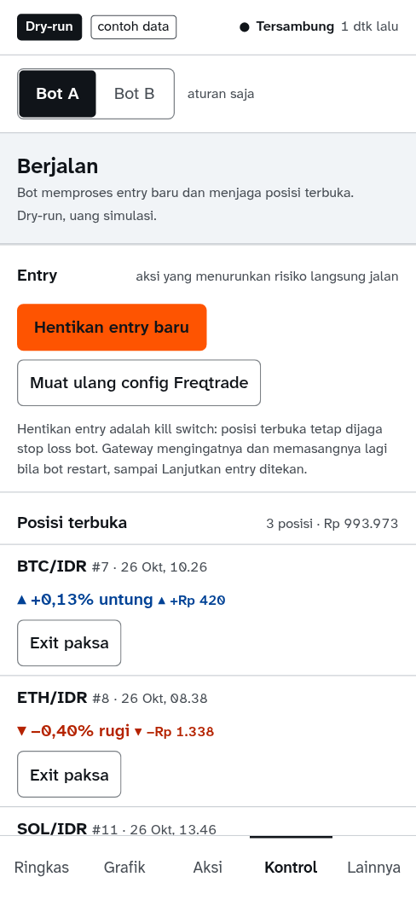
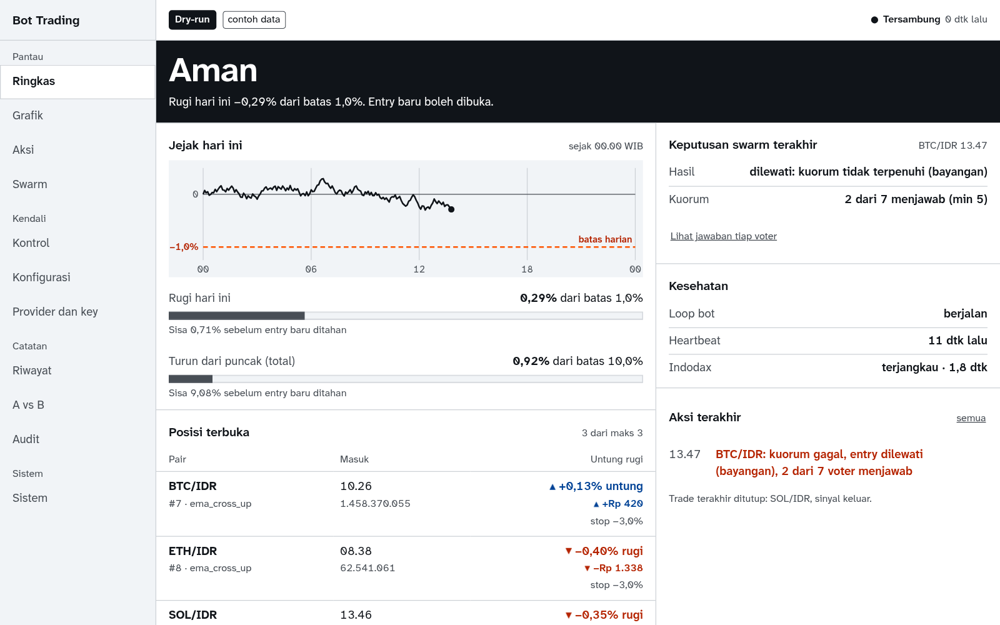
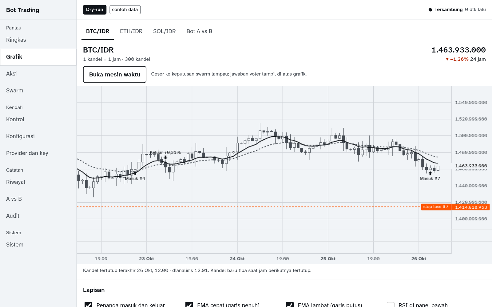
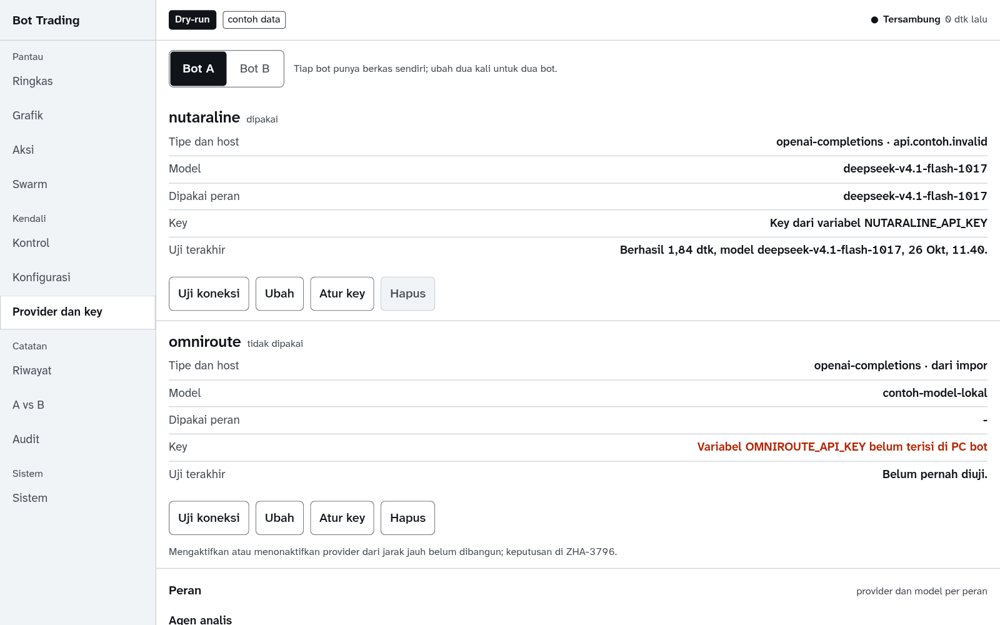
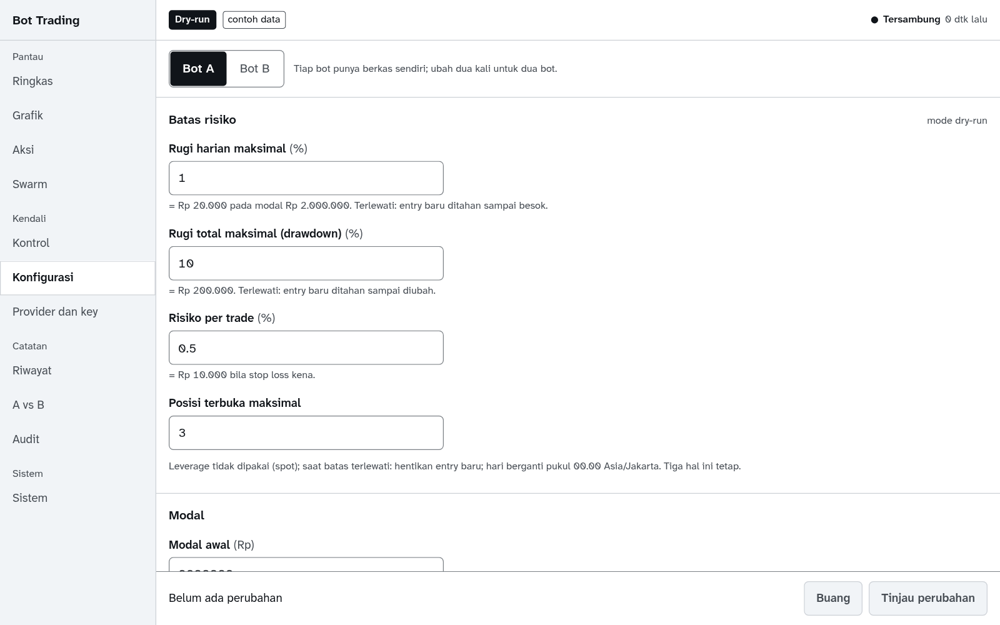
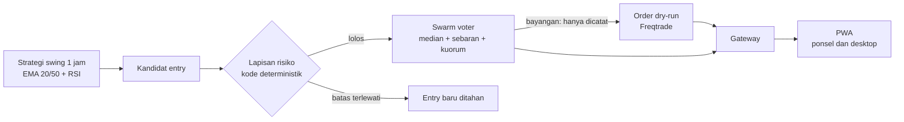

<p align="center"></p>

<p align="center">
  
  
  
  
  
</p>

Bot trading crypto spot yang berjalan 24 jam di PC sendiri, dengan panel kontrol PWA untuk ponsel dan desktop. Strategi aturan swing 1 jam membuat kandidat entry; **swarm** voter (banyak model, satu pertanyaan, hasil digabung dengan **median**) hanya boleh menyaring; batas rugi dan ukuran posisi dijaga **kode**, bukan prompt. English summary: an always-on spot crypto swing bot on Freqtrade, with an LLM voter swarm as an entry filter only, hard risk limits enforced in code, and a PWA control panel. Dry-run only.

> **Status jujur.** Proyek ini belum terbukti menghasilkan uang. Semuanya berjalan dry-run: tidak ada akun exchange, tidak ada key exchange, tidak ada uang sungguhan, dan mode live sengaja tidak bisa menyala di build ini. Backtest 3 tahun pada data Indodax setelah fee 0,2% dan pajak 0,21% per sisi memberi ekspektasi **negatif**: out-of-sample −0,832% per trade (221 trade, CI 95% −1,098% sampai −0,561%). Rinciannya di [docs/stage2-backtest.md](docs/stage2-backtest.md). Bukan nasihat keuangan.

## Tampilan

Layar di bawah dari gateway tiruan berdata contoh (penanda "contoh data" tampil di panel), bukan dari lari bot sungguhan.

<p align="center">
  
  
  
</p>

<p align="center">
  
  
  
  
  
  
</p>

Arah visualnya ditulis di [PRODUCT.md](PRODUCT.md) dan [DESIGN.md](DESIGN.md): satu jawaban besar yang terbaca dalam dua detik (Aman, Ditahan, Berhenti), warna sinyal hangat hanya untuk risiko, untung dan rugi selalu berpenanda plus atau minus dan arah, bukan sekadar merah dan hijau.

## Cara kerja



1. **Engine**: Freqtrade 2026.9 sebagai git submodule di `vendor/freqtrade` (tidak dimodifikasi). Strategi, konfigurasi, dan data pengguna ada di luar vendor.
2. **Lapisan risiko** (`engine/risk.py`): risiko per trade, batas rugi harian, batas drawdown total, maksimal posisi, kill switch. Tidak melewati AI. Menaikkan batas atau pindah mode butuh konfirmasi dua langkah; menurunkannya langsung.
3. **Swarm** (`swarm/tb_swarm`): voter dari banyak vendor menjawab pertanyaan bertipe yang sama dengan urutan opsi diacak. Agregasi memakai median, sebaran, dan kuorum; kurang dari kuorum berarti gagal tertutup. Adapter: System One wire (`/v1/systemone`), decisions API OpenRouter dan OpenAI, serta LLM biasa dengan structured output. Menambah voter cukup menambah satu blok konfigurasi. Mode `veto` ditolak skema sampai gerbang adopsinya lolos, jadi saat ini swarm hanya **bayangan**: mencatat apa yang akan diputuskan, tanpa memengaruhi order.
4. **Gateway** (`gateway/`): satu-satunya pintu PWA ke bot. Autentikasi sesi, endpoint baca, feed WebSocket, kontrol dua langkah dengan `Idempotency-Key` dan log audit, Web Push. API Freqtrade tidak pernah dibuka ke jaringan.
5. **Agen analis** (deepagents): laporan harian dan tanya-jawab dengan tool baca saja. Tidak ada tool yang bisa membuat order atau mengubah konfigurasi.
6. **PWA** (`pwa/`, Svelte + Vite): panel buatan sendiri, bukan FreqUI.

## Fitur

- Keadaan Aman, Ditahan, Berhenti dengan meter rugi harian dan drawdown total terhadap batas, penanda mode dry-run atau live, dan usia data.
- Grafik kandel live per pair dengan penanda entry dan exit, feed aksi waktu nyata, posisi dan order, kesehatan mesin dan provider.
- Keputusan swarm per voter (jawaban, median, sebaran, kuorum) beserta hasil sesudahnya: apakah entry yang akan dilewati ternyata rugi.
- Bot A (aturan saja) lawan bot B (aturan + swarm bayangan) dengan kurva ekuitas bertumpuk.
- Kontrol: jeda, hentikan entry, exit paksa, kunci pair, blacklist, dengan konfirmasi dua langkah yang menyebut konsekuensinya dalam rupiah.
- Editor konfigurasi tervalidasi skema, catatan perubahan, registri provider dan voter, uji koneksi provider. Key hanya bisa dimasukkan dari mesin bot sendiri dan tidak pernah dikembalikan utuh.
- Analitik: what-if konfigurasi, papan skor voter, uji stres, ekspor CSV, backtest dari UI, tampilan portofolio.
- Mesin waktu (geser ke keputusan lampau), lapisan berita dan Fear and Greed, tampilan terakhir saat offline, kanal Telegram opsional, dua bahasa (Indonesia dan Inggris).
- Notifikasi Web Push: fill, batas terlewati, kill switch, heartbeat hilang, kuorum gagal, ringkasan harian.

## Mulai cepat

Mencoba PWA tanpa bot, dengan gateway tiruan:

```bash
git clone --recurse-submodules https://github.com/tickernelz/trading-bot.git
cd trading-bot/pwa
NODE_ENV=development npm ci --include=dev
npm run mock-gateway &
npm run build && npm run preview
```

Buka http://127.0.0.1:4173, kata sandi gateway tiruan `contoh`. Membangun dan menjalankan dry-run sungguhan (Docker):

```bash
cp .env.example .env
mkdir -p user_data
cp config/config.example.yaml config/config.yaml
docker compose build bot
docker compose up -d bot
```

Isi variabel di `.env` dulu. Langkah lengkap, susunan dua bot dengan swarm bayangan, gateway, dan batas CPU ada di [docs/operations.md](docs/operations.md).

## Konfigurasi

Satu berkas YAML, divalidasi skema saat start; konfigurasi salah berarti bot tidak start, bukan jalan dengan tebakan. Contoh lengkap di [config/config.example.yaml](config/config.example.yaml). Batas bawaan dan semuanya bisa diubah:

| Pengaturan | Bawaan |
| --- | --- |
| Modal awal | Rp 2.000.000, profit dikomposisi |
| Rugi harian maksimal | 1,0% |
| Drawdown total maksimal | 10,0% |
| Risiko per trade | 0,5% |
| Posisi terbuka maksimal | 3, spot saja, tanpa leverage |
| Mode swarm | bayangan |
| Biaya compute LLM | dicatat, tanpa batas |

API key lewat variabel lingkungan (`api_key_env`) atau langsung di `config/config.yaml`. Keduanya ada di `.gitignore`; berkas config menyimpan key sebagai teks biasa di disk, jadi anggap bocor bila berkas itu tersalin keluar.

## Batas yang perlu diketahui

- Indodax tidak didukung resmi oleh Freqtrade 2026.9; data OHLCV terambil, tetapi jalur order live belum pernah dijalankan. Karena itu mode live tidak bisa menyala di build ini, dan stop loss berjalan di sisi bot (PC harus menyala).
- Pajak 0,21% per sisi berasal dari sumber sekunder dan belum diverifikasi dari dokumen resmi.
- Swarm diuji sebagai penyaring yang diukur, bukan sumber profit yang diasumsikan. Bukti ensemble menaikkan profit trading belum ditemukan; yang ada untuk prediksi peristiwa, bukan harga ([docs/research-swarm-pwa.md](docs/research-swarm-pwa.md)).
- Selama pengujian semua voter memakai model yang sama, jadi kesalahan mereka berkorelasi. Nilai swarm baru bisa diukur dengan voter lintas vendor di forward test.
- Uji mesin 7 hari non-stop pada aplikasi penuh sedang berjalan; hasilnya belum ada.

## Struktur

| Jalur | Isi |
| --- | --- |
| `engine/` | launcher, skema konfigurasi, lapisan risiko, strategi, layanan bayangan, penyimpanan keputusan |
| `swarm/` | paket `tb_swarm`: voter, adapter, agregasi, agen analis |
| `gateway/`, `analytics/` | gateway PWA dan rute analitik |
| `pwa/` | panel PWA dan gateway tiruan |
| `scripts/` | menjalankan seluruh mesin sebagai unit systemd, ukur, rekam fixture, backtest |
| `docker/`, `docker-compose.yml` | image turunan Freqtrade |
| `docs/` | [plan](docs/plan.md), [kontrak gateway](docs/gateway-api.md), [operasi](docs/operations.md), [riset](docs/research-swarm-pwa.md), temuan per tahap |
| `vendor/freqtrade` | submodule Freqtrade, terkunci di tag 2026.9 |

## Tes

```bash
docker compose --profile test build tests
docker compose --profile test run --rm tests
cd pwa && npm test
```

Tes engine berjalan di dalam image turunan Freqtrade supaya versi Freqtrade, ccxt, dan pandas sama dengan mesin. Hook git (`git config core.hooksPath .githooks`) menolak komentar di kode kita dan commit yang bukan Conventional Commits.

## Lisensi

[GPL-3.0](LICENSE), sama dengan Freqtrade: strategi dan launcher mengimpor Freqtrade dan image Docker diturunkan darinya. Perangkat lunak ini disediakan apa adanya; trading menanggung risiko kehilangan seluruh modal.
