<p align="center">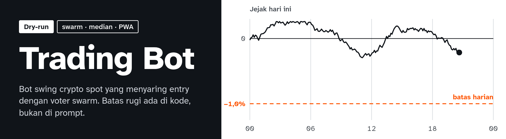</p>

<p align="center">
  
  
  
  
  
</p>

An always-on spot crypto swing bot that runs on your own PC, with a PWA control panel for phone and desktop. A rule-based strategy on 1-hour candles, chosen in config, proposes entries. A **swarm** of voters (many models, one typed question, answers combined with the **median**) may only filter them. Loss limits and position sizing are enforced by **code**, not by prompts.

> **Honest status.** This project has not been shown to make money. Everything runs in dry-run: no exchange account, no exchange keys, no real funds, and live mode is deliberately unable to start in this build. The default strategy wins often but loses money after costs: on Indodax data from 2022-07 to 2026-04, after the official taker fees and the 0.21% tax on sells, it won 77.1% of 519 trades with a **negative** expectancy of -0.599% per trade (95% CI -1.07% to -0.15%); on the untouched last six months it won 77.8% of 54 trades at -0.112% per trade (95% CI -1.47% to +1.11%). Configurations whose expectancy is positive with a 95% CI above zero (25 of 93, before correcting for testing 93) win only 34% to 57% of trades and are unstable from period to period; the few that win 60% to 68% with a positive mean have CIs that include zero. Details in [docs/strategy-research.md](docs/strategy-research.md). Not financial advice.

## Screens

The screens below come from the PWA running against a mock gateway with sample data (the panel shows a "sample data" badge), not from a live bot run.

<p align="center">
  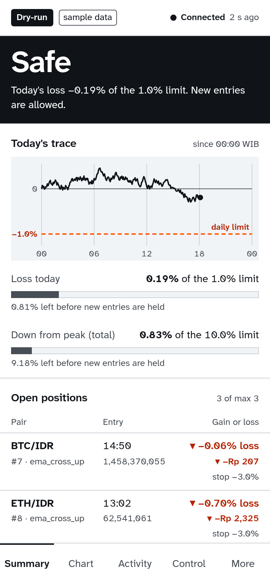
  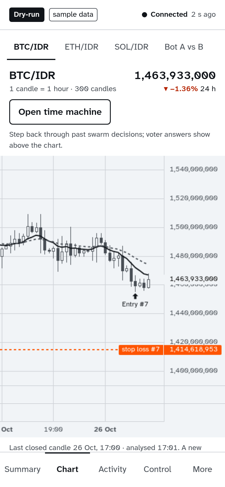
  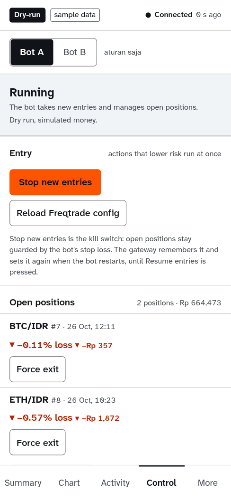
</p>

<p align="center">
  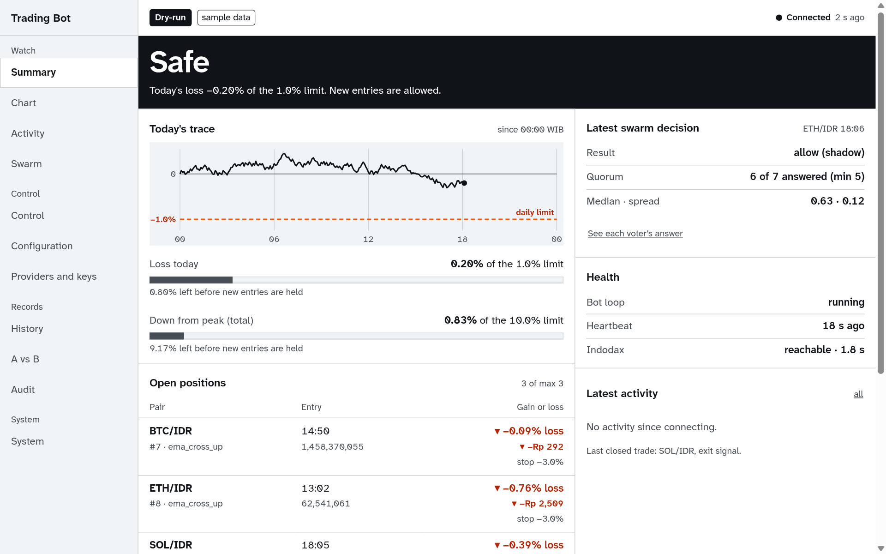
  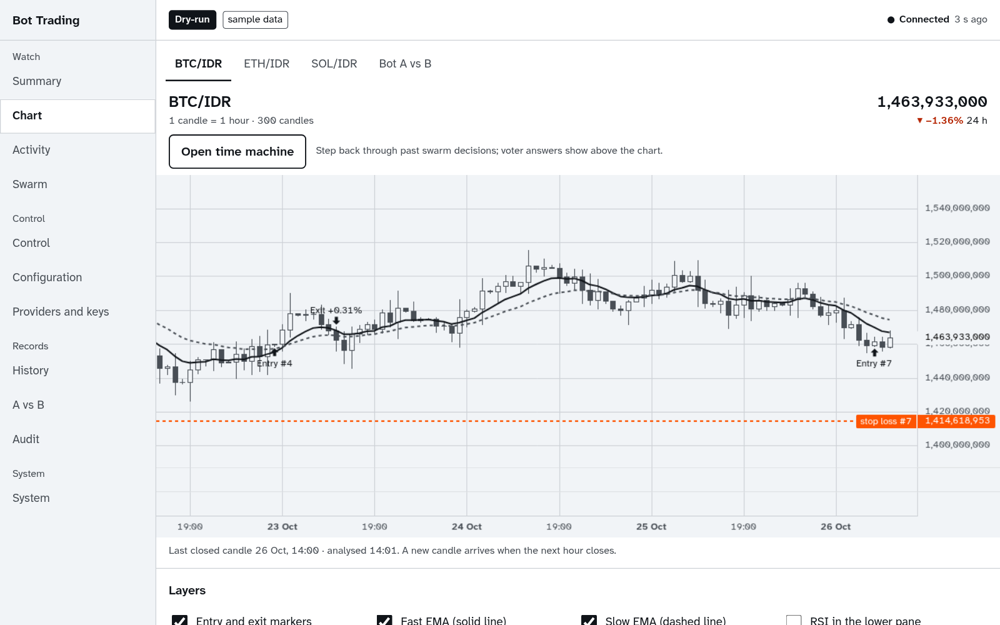
  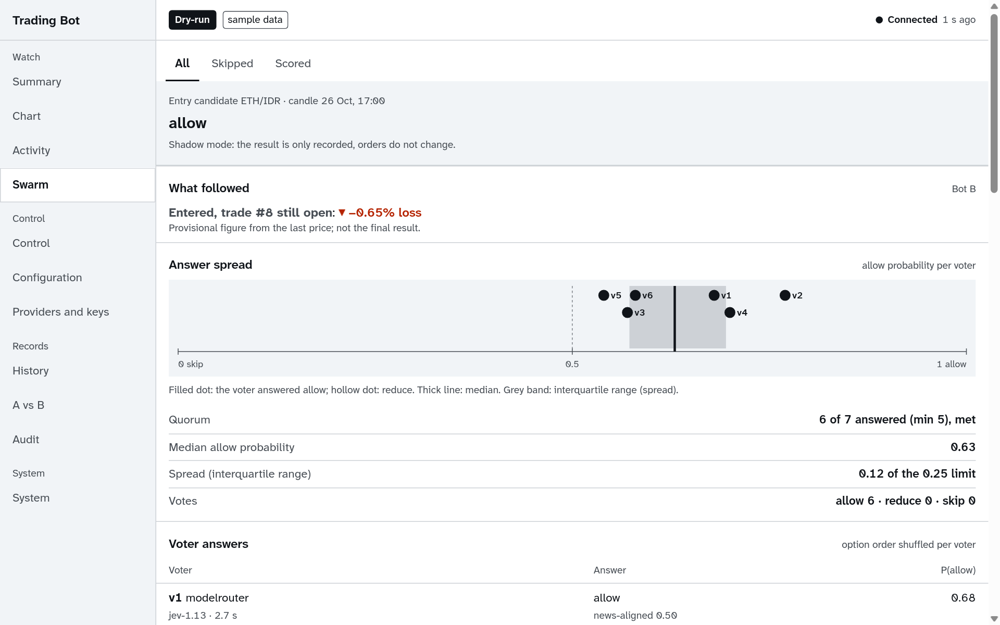
  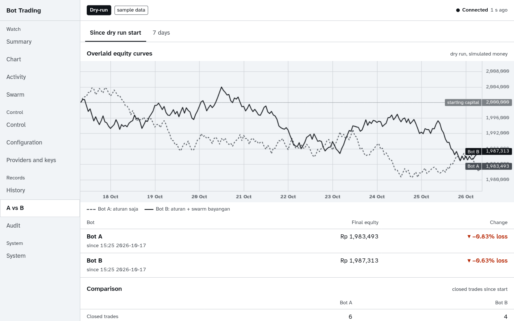
  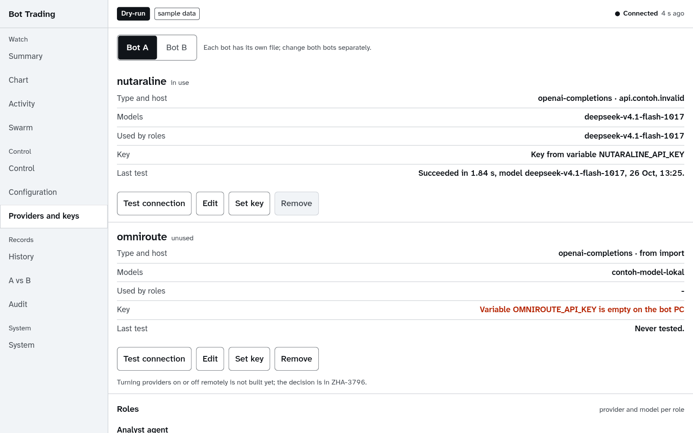
  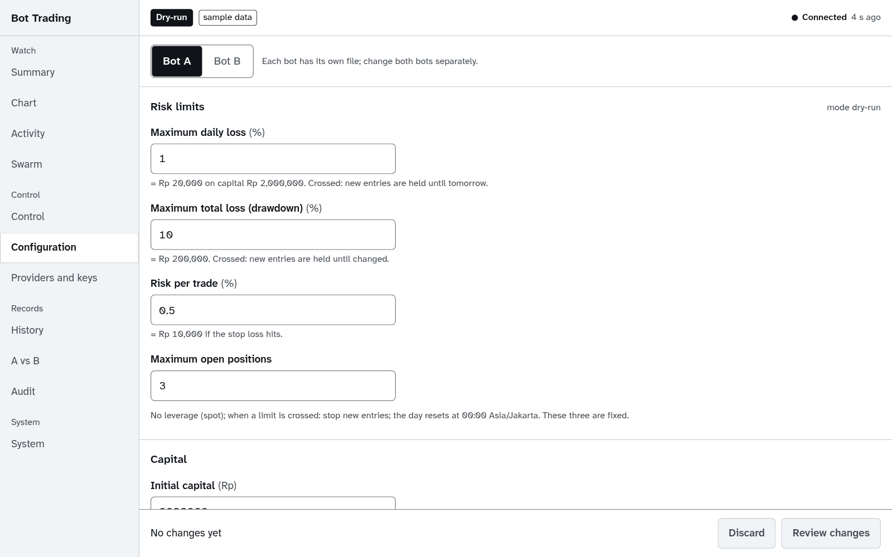
</p>

The visual direction is written down in [PRODUCT.md](PRODUCT.md) and [DESIGN.md](DESIGN.md): one large answer readable in two seconds (Safe, Held, Stopped), a warm signal colour reserved for risk, and gains and losses always marked with a sign and a direction rather than only red and green.

## How it works

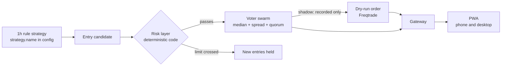

1. **Engine**: Freqtrade 2026.9 as a git submodule in `vendor/freqtrade` (unmodified). Strategy, configuration and user data live outside the vendor tree.
2. **Risk layer** (`engine/risk.py`): risk per trade, daily loss limit, total drawdown limit, maximum open positions, kill switch. It never goes through an AI. Raising a limit or switching mode takes a two-step confirmation; lowering a limit applies immediately.
3. **Swarm** (`swarm/tb_swarm`): voters from several vendors answer the same typed question with the option order shuffled. Aggregation uses the median, the spread and a quorum; below quorum the entry fails closed. Adapters: the System One wire (`/v1/systemone`), the OpenRouter and OpenAI decisions APIs, and ordinary LLMs with structured output. Adding a voter is one block of configuration. `veto` mode is rejected by the schema until its adoption gate passes, so the swarm is **shadow only** today: it records what it would decide and never affects an order.
4. **Gateway** (`gateway/`): the only door between the PWA and the bot. Session auth, read endpoints, a WebSocket feed, two-step controls with an `Idempotency-Key` and an audit log, Web Push. The Freqtrade API is never exposed to the network.
5. **Analyst agent** (deepagents): a daily report and Q&A with read-only tools. No tool can place an order or change configuration.
6. **PWA** (`pwa/`, Svelte + Vite): a purpose-built panel, not FreqUI.

## Features

- A Safe, Held or Stopped state with meters for the daily loss and the total drawdown against their limits, a dry-run or live badge, and the age of the data.
- Live candlestick chart per pair with entry and exit markers, a real-time activity feed, positions and orders, engine and provider health.
- Per-voter swarm decisions (answer, median, spread, quorum) with the outcome afterwards: did an entry that would have been skipped turn out to lose?
- Bot A (rules only) against bot B (rules plus shadow swarm) with stacked equity curves.
- Controls: pause, hold new entries, force exit, pair locks, blacklist, each with a two-step confirmation that states the consequence in rupiah.
- A schema-validated configuration editor with a change log, provider and voter registry, and a connection test per provider. Keys can only be entered from the bot's own machine and are never returned in full.
- Analytics: configuration what-if, voter scoreboard, stress test, CSV export, backtest from the UI, portfolio view.
- Time machine (step back through past decisions), news and Fear and Greed layer, last view available offline, an optional Telegram channel.
- Web Push notifications: fills, limit crossed, kill switch, heartbeat lost, quorum failed, daily summary.
- Languages: English (default) and Indonesian, with more addable. See [docs/i18n.md](docs/i18n.md).

## Quick start

Try the PWA without a bot, against the mock gateway:

```bash
git clone --recurse-submodules https://github.com/tickernelz/trading-bot.git
cd trading-bot/pwa
NODE_ENV=development npm ci --include=dev
npm run mock-gateway &
npm run build && npm run preview
```

Open http://127.0.0.1:4173. The mock gateway password is `example`. To build and run the real dry-run (Docker):

```bash
cp .env.example .env
mkdir -p user_data
cp config/config.example.yaml config/config.yaml
docker compose build bot
docker compose up -d bot
```

Fill in the variables in `.env` first. The full steps, the two-bot layout with the shadow swarm, the gateway and the CPU limits are in [docs/operations.md](docs/operations.md).

## Configuration

One YAML file, validated against a schema at start. A bad configuration means the bot refuses to start instead of running on guesses. A full example is in [config/config.example.yaml](config/config.example.yaml). Defaults, all changeable:

| Setting | Default |
| --- | --- |
| Starting capital | Rp 2,000,000, profits compounded |
| Maximum daily loss | 1.0% |
| Maximum total drawdown | 10.0% |
| Risk per trade | 0.5% |
| Maximum open positions | 3, spot only, no leverage |
| Swarm mode | shadow |
| LLM compute cost | recorded, not limited |

API keys come from environment variables (`api_key_env`) or are written directly into `config/config.yaml`. Both are git-ignored. A key in the config file is stored as plain text on disk, so treat it as leaked if that file ever leaves the machine.

## Limits you should know about

- Indodax is not officially supported by Freqtrade 2026.9. OHLCV data works, but the live order path has never been run. For that reason live mode cannot start in this build, and the stop loss runs on the bot side, so the PC must stay on.
- The strategy research ([docs/strategy-research.md](docs/strategy-research.md)) uses the official Indodax all-in fee table and PMK 50/2025: taker 0.20555% on a buy and 0.41555% on a sell, the 0.21% tax applying to sells only. The dry-run bot itself charges `exchange.fee_pct` (0.2%) on both sides, about 0.22 points per round trip less than those costs, so its dry-run results look better than the research. The research assumes taker fills and no slippage; +0.10% slippage per side lowers the default's expectancy by about 0.2 points per trade.
- The default strategy (`RuleStrategy`, RSI 14 below 30 on 1h, 3% take-profit, 10% stop) gets its high win rate from a small target and a wide stop: each stop costs about 10.6% of the stake, as much as four to five wins of about 2.4%. Random entries with the same exits win as often. `SwingEmaRsi` can still be selected with `strategy.name`.
- The swarm is built as a filter that gets measured, not as an assumed source of profit. Evidence that ensembles raise trading profit has not been found; what exists is for event forecasting, not prices ([docs/research-swarm-pwa.md](docs/research-swarm-pwa.md)).
- During testing every voter used the same model, so their errors are correlated. The swarm's value can only be measured with voters from several vendors in a forward test.
- A 7-day non-stop engine test on the complete application is in progress; there are no results yet.

## Layout

| Path | Contents |
| --- | --- |
| `engine/` | launcher, configuration schema, risk layer, strategy, shadow service, decision store |
| `swarm/` | the `tb_swarm` package: voters, adapters, aggregation, analyst agent |
| `gateway/`, `analytics/` | the PWA gateway and the analytics routes |
| `pwa/` | the PWA panel and the mock gateway |
| `scripts/` | run the whole stack as systemd units, measure, record fixtures, backtest |
| `docker/`, `docker-compose.yml` | the image derived from Freqtrade |
| `docs/` | [plan](docs/plan.md), [gateway contract](docs/gateway-api.md), [operations](docs/operations.md), [research](docs/research-swarm-pwa.md), [languages](docs/i18n.md), per-stage findings |
| `vendor/freqtrade` | the Freqtrade submodule, pinned to tag 2026.9 |

## Tests

```bash
docker compose --profile test build tests
docker compose --profile test run --rm tests
cd pwa && npm test
```

The engine tests run inside the Freqtrade-derived image so the Freqtrade, ccxt and pandas versions match the engine. The git hooks (`git config core.hooksPath .githooks`) reject comments in our code and commits that are not Conventional Commits.

## License

[GPL-3.0](LICENSE), the same as Freqtrade: the strategy and launcher import Freqtrade and the Docker image derives from it. The software is provided as is, and trading risks losing all of your capital.
